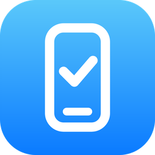
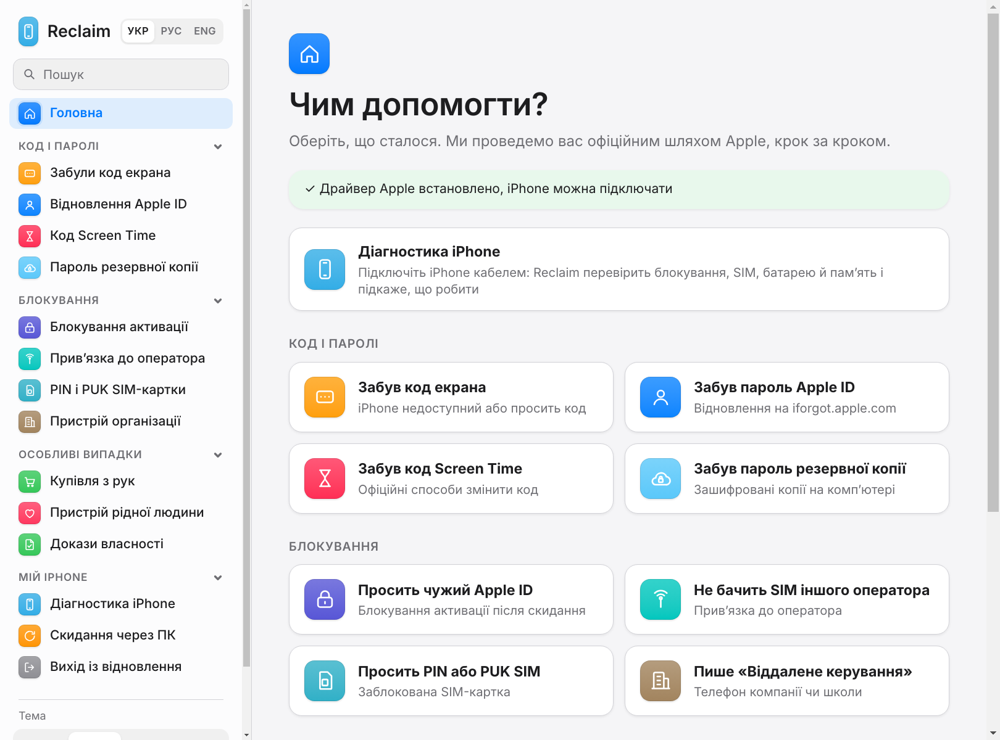
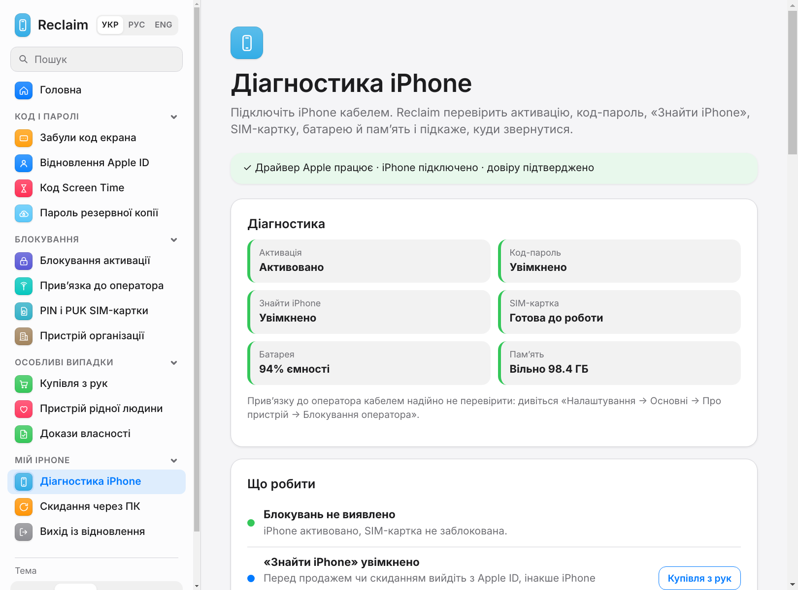
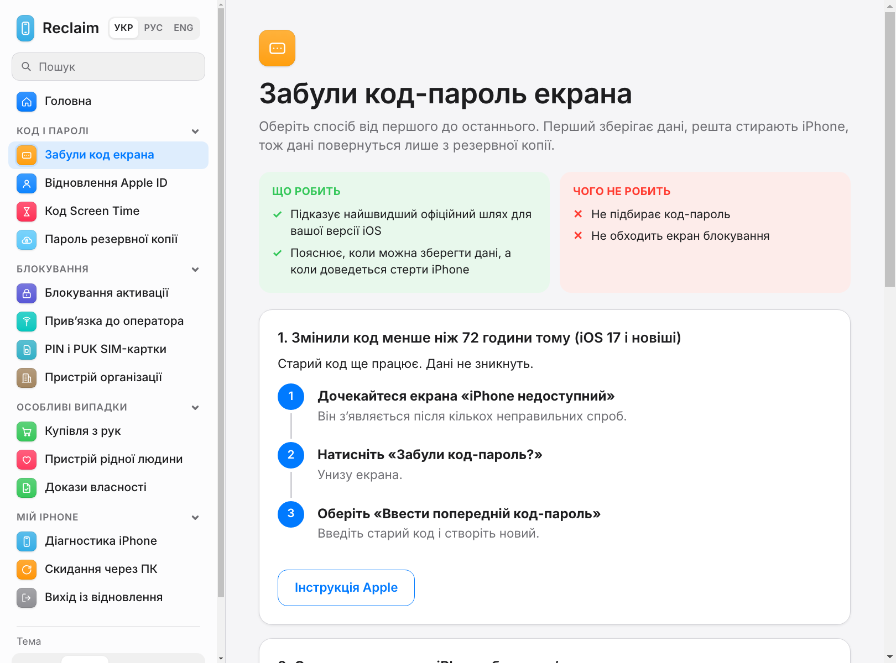
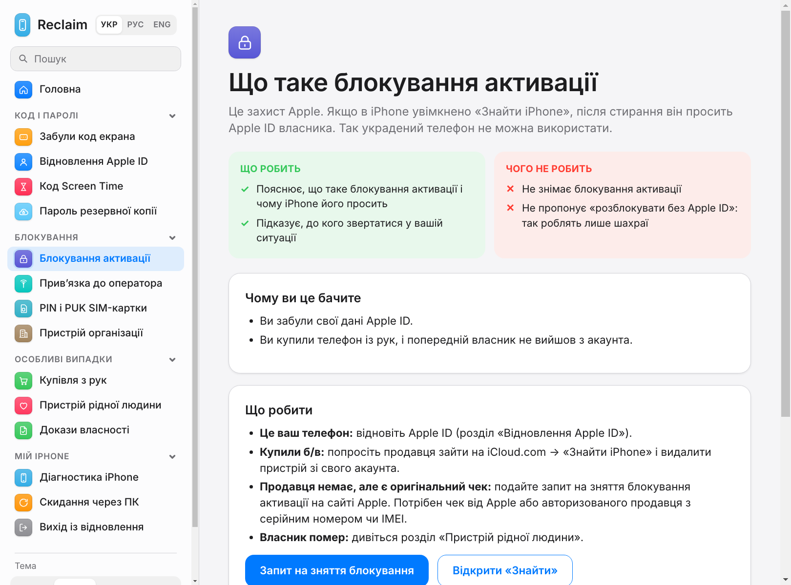
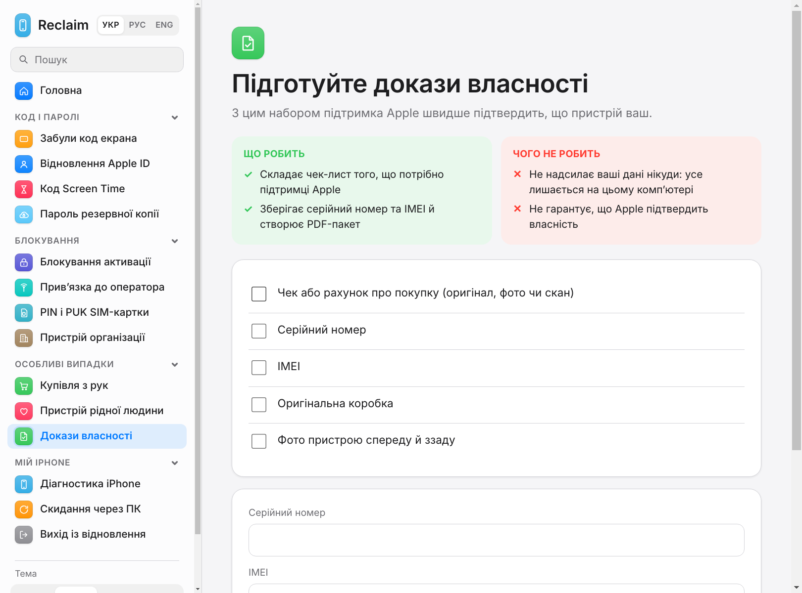
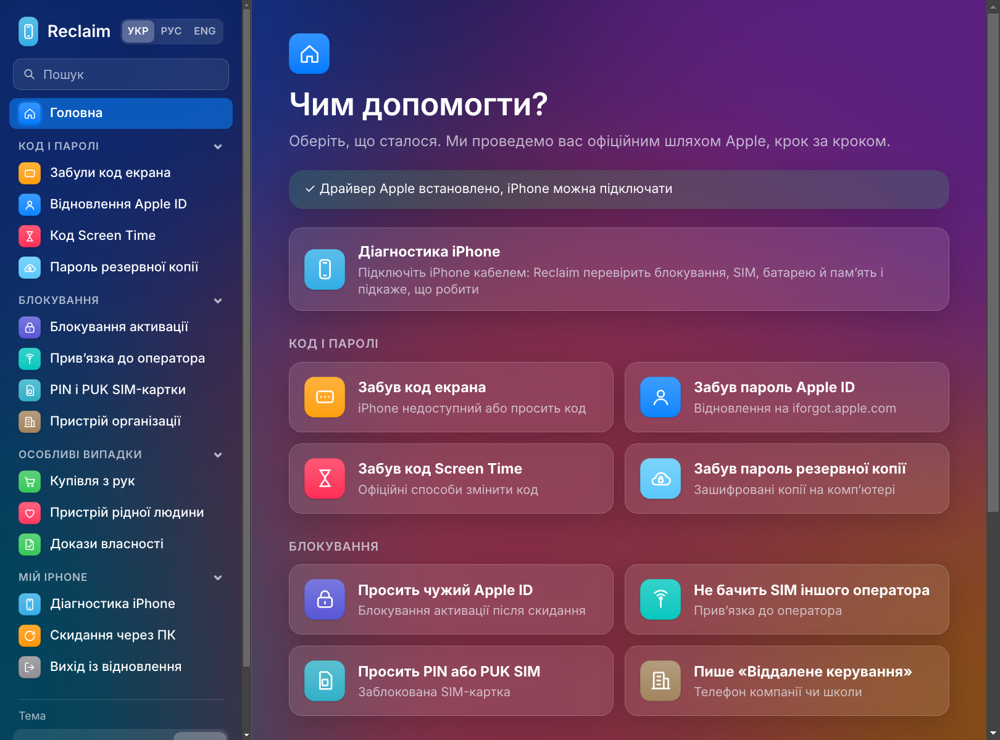
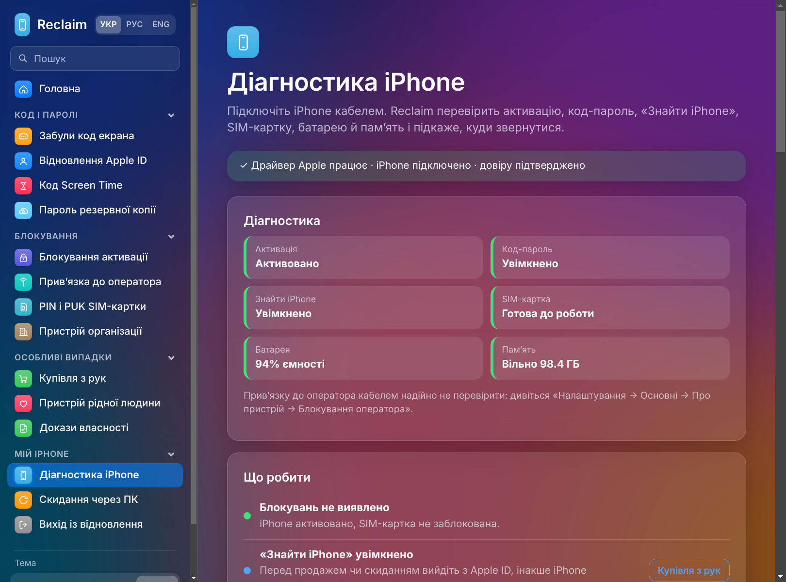

<div align="center">



# Reclaim

**Забув код iPhone чи пароль Apple ID? Поверни доступ чесним шляхом.**<br>
Windows-застосунок у стилі Apple: діагностика iPhone через кабель і покрокові<br>
офіційні шляхи Apple для 12 ситуацій. Без обходів блокувань і прихованих завантажень.

[](../../actions/workflows/release.yml)
[](../../releases/latest)
[](LICENSE)


### [⬇️ Завантажити останній реліз](../../releases/latest/download/Reclaim-setup.exe) · [Можливості](#що-вміє) · [Запуск](#запуск-з-вихідного-коду) · [Збірка](#збірка-встановлювача) · [Сайт](https://dimonchikk.github.io/Reclaim/)

<picture>
  <source media="(prefers-color-scheme: dark)" srcset="https://raw.githubusercontent.com/Dimonchikk/Reclaim/main/screenshots/home-dark.png">
  
</picture>

</div>

---

> [!IMPORTANT]
> **Reclaim не обходить блокування активації і не знімає Apple ID без пароля власника.** Усі кроки ведуть до офіційних інструментів Apple.

## Що вміє

| | |
|---|---|
| 🔢 **Забули код екрана** | старий код протягом 72 годин, скидання на iPhone, через «Знайти» чи комп’ютер |
| 🔑 **Відновлення Apple ID** | забули пароль чи пошту, Apple ID заблоковано: офіційне відновлення Apple |
| ⏳ **Код Screen Time** | що робити, якщо забуто код «Екранного часу» |
| ☁️ **Пароль резервної копії** | як скинути пароль зашифрованих копій на самому iPhone |
| 🔒 **Блокування активації** | iPhone просить чужий Apple ID: що робити і як подати запит до Apple |
| 📶 **Прив’язка до оператора** | як перевірити й попросити оператора зняти прив’язку |
| 💳 **PIN і PUK SIM-картки** | де взяти PUK і чому не можна вгадувати |
| 🏢 **Пристрій організації** | «Віддалене керування»: до кого звернутися |
| 🛒 **Купівля з рук** | чек-лист до оплати, щоб не купити заблокований iPhone |
| 🕊️ **Пристрій рідної людини** | офіційний шлях Apple для родини |
| 📄 **Докази власності** | чек, серійний номер та IMEI в одному PDF для підтримки Apple |
| 🩺 **Діагностика iPhone** | через кабель: активація, код-пароль, «Знайти iPhone», SIM, здоров’я батареї й цикли, пам’ять, IMEI, і поради, куди звернутися |
| ♻️ **Скидання й вихід із режиму відновлення** | комбінації кнопок для кожної моделі |
| 🪟 **Теми** | авто, світла, темна й «Скло» з розмитими шпалерами робочого стола |
| 🌐 **Мови** | українська, російська й англійська, перемикач поруч із назвою |

<details>
<summary><b>📸 Більше знімків екрана</b></summary>
<br>
<div align="center">

| | |
|:---:|:---:|
| <picture><source media="(prefers-color-scheme: dark)" srcset="https://raw.githubusercontent.com/Dimonchikk/Reclaim/main/screenshots/device-dark.png"></picture><br>Діагностика iPhone | <picture><source media="(prefers-color-scheme: dark)" srcset="https://raw.githubusercontent.com/Dimonchikk/Reclaim/main/screenshots/passcode-dark.png"></picture><br>Забули код екрана |
| <picture><source media="(prefers-color-scheme: dark)" srcset="https://raw.githubusercontent.com/Dimonchikk/Reclaim/main/screenshots/activation-dark.png"></picture><br>Блокування активації | <picture><source media="(prefers-color-scheme: dark)" srcset="https://raw.githubusercontent.com/Dimonchikk/Reclaim/main/screenshots/proof-dark.png"></picture><br>Докази власності |
| <br>Тема «Скло» | <br>Діагностика в темі «Скло» |

</div>
</details>

## Запуск з вихідного коду
```
npm install
npm start
```
Або двічі клацніть `run.bat` на Windows. Потрібен Node.js.

## Збірка встановлювача
```
npm run dist
```
Готовий NSIS-інсталятор з'явиться в `dist/`.

## Потрібно для роботи з iPhone
Windows і драйвер Apple (служба Apple Mobile Device Service) з застосунку Apple Devices (Microsoft Store) або iTunes. Застосунок перевіряє це сам і лише пропонує відкрити офіційне встановлення, нічого не завантажуючи приховано. Утиліти libimobiledevice (`ideviceinfo`, `idevice_id`, `idevicepair`, `idevicediagnostics`) вбудовані в `bin/`; походження й ліцензії: [`bin/NOTICE.txt`](bin/NOTICE.txt).

## Сайт (GitHub Pages)
Сайт лежить у корені репозиторію: `index.html`, `script.js`, `config.js`, `icon.png` і папка `screenshots/` (світлі знімки та `-dark`). Це чистий HTML, CSS і JS без збірки. Репозиторій, назва файлу інсталятора й версія задаються в одному місці: `config.js`. На GitHub Pages репозиторій визначається з адреси автоматично, а кнопка «Завантажити» веде прямо на `releases/latest/download/Reclaim-setup.exe`; номер версії сайт бере з останнього релізу. Файл `.nojekyll` вимикає обробку Jekyll.

Налаштування: **Settings → Pages → Source: Deploy from a branch → main / (root)**. Сайт оновлюється після кожного пушу в `main`. Сайт не потрапляє в інсталятор: у збірку входять лише файли зі списку `build.files` у `package.json`.

## Випуск
1. Підніміть `version` у `package.json` (коротка версія `1.0` пишеться там як `1.0.0`) і в `config.js` та допишіть розділ `## номер` у `CHANGES.md`.
2. Запуште в `main`.
3. На GitHub: **Actions → Збирання → Run workflow**, у полі «Версія» впишіть номер, наприклад `1.0`.
4. Workflow збере інсталятор на Windows і створить **чернетку** релізу з описом із `CHANGES.md`. Перевірте файл і натисніть **Publish release**: після цього кнопка на сайті й перевірка оновлень у застосунку побачать нову версію.

Порожнє поле «Версія» робить лише пробне збирання (файл у Artifacts).

## Мережа й дані
Єдиний мережевий запит застосунку: раз на годину (і за кнопкою «Шукати оновлення») він питає GitHub API про номер останнього релізу. Нічого не завантажується й не встановлюється без дії користувача. Історія підключених iPhone зберігається лише в папці даних застосунку на комп'ютері й нікуди не надсилається; її можна очистити в «Мій iPhone».

## Структура
```
main.js, preload.js   головний процес і міст
CHANGES.md            журнал змін (розділ «## номер» стає описом релізу)
LICENSE               ліцензія MIT
build/                іконка застосунку та інсталятора
src/                  інтерфейс застосунку (i18n.js і lang/ — переклади російською та англійською)
bin/                  вбудовані утиліти libimobiledevice + NOTICE.txt
index.html, script.js, config.js, icon.png, screenshots/   сайт (GitHub Pages)
.github/workflows/    release.yml (збирання інсталятора)
```

## Ліцензія
Код Reclaim поширюється за ліцензією [MIT](LICENSE): його можна вільно використовувати, змінювати й поширювати, зберігши повідомлення про авторство.

Вбудовані утиліти в `bin/` під MIT не підпадають і мають власні ліцензії (LGPL-2.1+/GPL, OpenSSL: Apache-2.0), див. `bin/NOTICE.txt`. Apple, iPhone, iTunes та Apple ID є торговими марками Apple Inc.; проєкт з Apple не пов'язаний.
